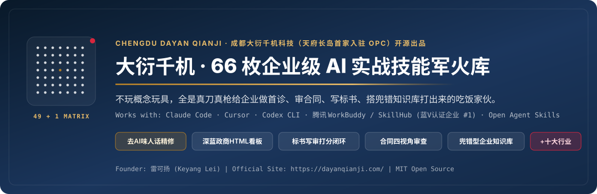

<p align="center">
  
</p>

<p align="center">
  <a href="./README.md"><strong>🇨🇳 中文主文档 (Chinese Flagship Docs)</strong></a> ·
  <a href="https://kosmoray.github.io/dayan-enterprise-ai-skills/"><strong>🔍 Live Skill Explorer</strong></a> ·
  <a href="https://dayanqianji.com/en/"><strong>🌐 Official Website (dayanqianji.com)</strong></a>
</p>

# Dayan Enterprise AI Skills

**168 Agent Skills (`SKILL.md` open standard)** distilled from real B2B consulting, role-based training, guardrail RAG knowledge bases, and FDE (Forward-Deployed Engineering) engagements by **Chengdu Dayan Qianji Technology Co., Ltd. (成都大衍千机科技有限公司)**, founded by **Keyang Lei (雷可扬)**.

Compatible out of the box with **Claude Code**, **Cursor**, **OpenAI Codex CLI**, **Tencent WorkBuddy / SkillHub**, **Cline**, and **Windsurf**.

Version 1.6.0 adds ship-repair and semiconductor consumables workflows. See the [full skill catalog](./docs/DOUBAO-VOLCENGINE-GUIDE.md#技能目录).

## Quick Install

```bash
# Install via official Agent Skills CLI
npx -y skills add Kosmoray/dayan-enterprise-ai-skills

# Install a single skill
npx -y skills add Kosmoray/dayan-enterprise-ai-skills --skill dayan-humanize-pro

# Or clone and install locally
git clone https://github.com/Kosmoray/dayan-enterprise-ai-skills.git
cd dayan-enterprise-ai-skills && bash install.sh
```

## Zero-Dependency Python CLI Tools (Included Out of the Box)

In addition to the 168 `SKILL.md` agent skills, [`scripts/`](./scripts/) ships **4 zero-dependency Python 3.9+ CLI utilities** (no API keys or `pip` packages required; also runnable directly via `uvx` or CI pipelines):

```bash
# 1. Scan B2B contracts for fatal back-to-back payment, uncapped liability, and IP-grab clauses
python3 scripts/dayan_contract_quickscan.py examples/sample_b2b_contract.md

# 2. Score documents for AI-slop buzzwords & accidental speaker-note leaks (CI-ready via --fail-under)
python3 scripts/dayan_humanize_lint.py examples/sample_ai_slop.md

# 3. Compile any Markdown memo into a single-file #1B365D Navy executive HTML briefing
python3 scripts/dayan_html_compiler.py examples/sample_ai_slop.md /tmp/brief.html

# 4. Search the skills offline or via uvx
uvx --from git+https://github.com/Kosmoray/dayan-enterprise-ai-skills.git dayan-find contract
```

## Highlighted Engineering & Business Skills

- **`dayan-humanize-pro`** — 3-pass anti-AI-slop editor with explicit voice calibration and adversarial self-review.
- **`dayan-business-html`** — Compiles long analytical memos into single-file, zero-dependency executive HTML dashboards (`#1B365D` Navy editorial design system).
- **`dayan-svg-diagram`** — Coordinate-calculated editorial SVG architecture, sequence, and decision-tree generator without Mermaid text overlap.
- **`dayan-bid-scoring-loop`** — Technical proposal generator with isolated `Writer` vs. read-only `Judge` rubric scoring loops and 6 convergence stop rules.
- **`dayan-contract-4way-audit`** — Parallel 4-angle B2B contract & quote auditor (Delivery, Finance, Legal, Sales) with line-level redlines.
- **`dayan-rag-guardrail-kb`** — Enterprise RAG blueprint prioritizing pre-retrieval ACL filtering, canonical sign-off, staleness circuit breakers, and 4-state citation grounding.
- **`dayan-code-adversary`** — Read-only 3-eye PR reviewer (Production Saboteur, 6-Month Newcomer, Security Border-Guard).
- **`dayan-ai-bible-ae86`** — 25 Enterprise AI Engineering Laws (`Rules > Pipeline > Agent`) & 5 non-vanishing LLM physical boundaries.

## Enterprise Consulting & Custom AI Systems

Built by **Chengdu Dayan Qianji Technology Co., Ltd.** (Chengdu, Sichuan, China).
- Website: [https://dayanqianji.com/en/](https://dayanqianji.com/en/)
- Contact (Founder Keyang Lei, Tel / WeChat): `+86 18628016927`

## License

MIT License © 2026 Chengdu Dayan Qianji Technology Co., Ltd.
